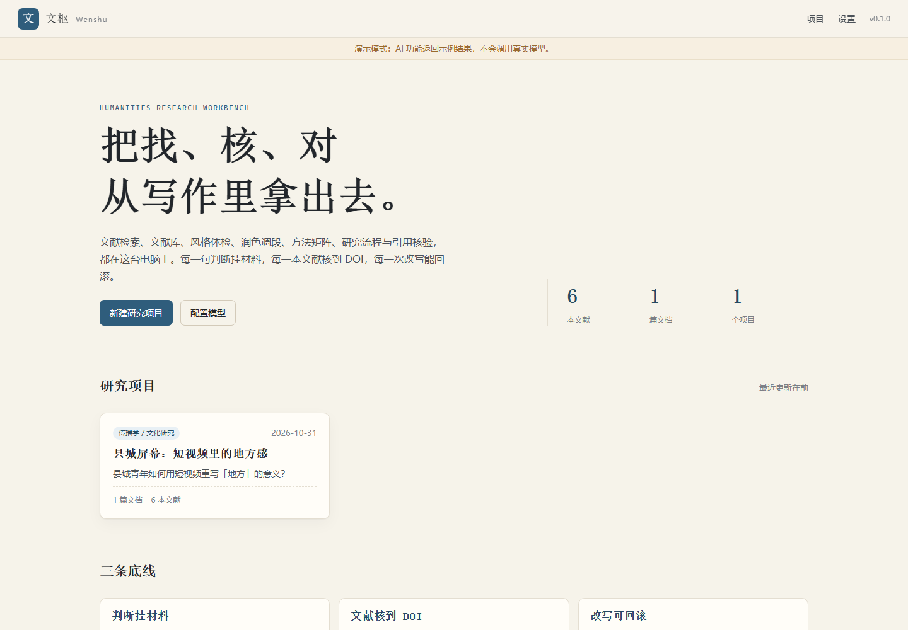
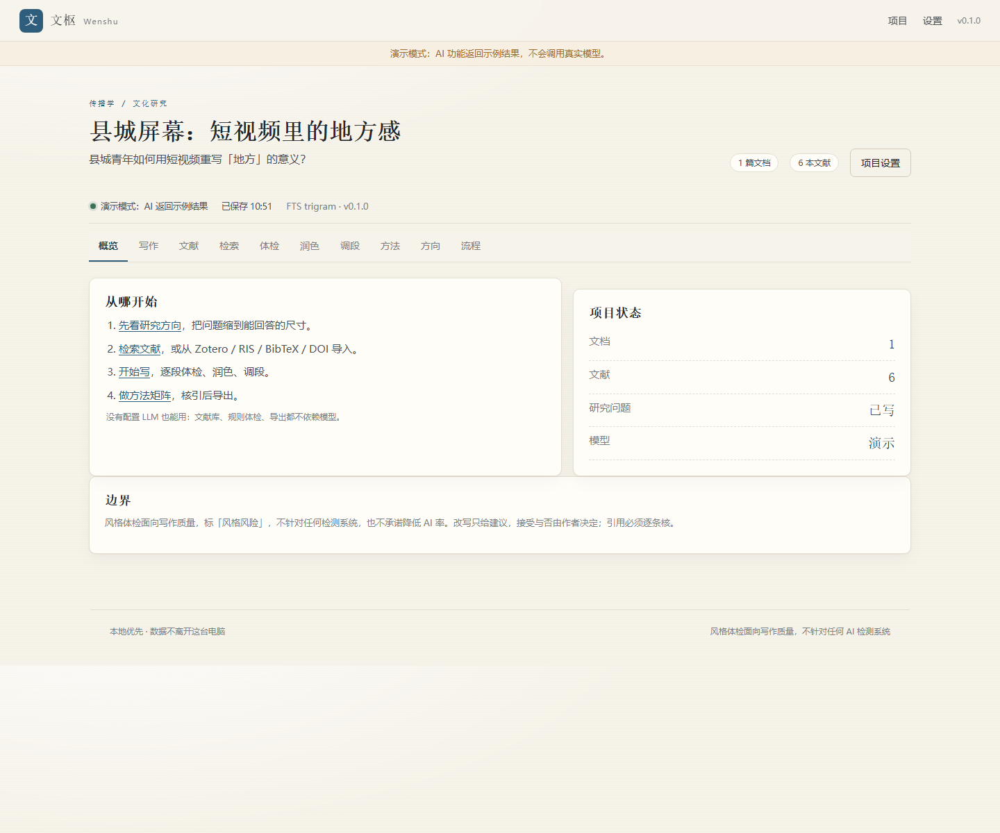

# 文枢 Wenshu

> 本地优先的中文文科科研文献与写作工作台。
> 找文献、建库、体检文风、润色调段、做方法矩阵、核引用、导 docx——都在自己电脑上。





[](https://github.com/TheIslland/wenshu/actions/workflows/ci.yml)
[](LICENSE)
[](pyproject.toml)

## 它解决什么

文科论文最贵的不是「写」，是**找、核、对**：

- 中文库没有公开 API，英文库各一套，文献散在 Zotero、PDF 和浏览器书签里；
- 通用 AI 产出「正确的废话」——抽象、对仗、没有材料锚点；
- AI 会编文献，导出前没人逐条核 DOI、卷期、页码；
- 方法和理论堆在一起，说不清「我和别人做了什么不同」。

文枢把这条链路收进一个本地 Web 工作台，只坚持三条：

1. **判断挂材料**：没有证据的断言不生成，只标「待补材料」。
2. **文献核到 DOI**：Crossref / OpenAlex 比对，核不到标红，导出附清单。
3. **改写可回滚**：逐段 diff，接受前看得见每一处改动。

## 30 秒看演示

```bash
# 需要 uv：https://docs.astral.sh/uv/
git clone https://github.com/TheIslland/wenshu.git
cd wenshu
uv sync
uv run wenshu --demo
```

浏览器会自动打开 `http://127.0.0.1:8765`，里面有一个虚构项目「县城屏幕：短视频里的地方感」，可以直接点写作、体检、方法矩阵、流程看板。

> 演示数据是虚构的，文献全部标注「示例」，不要引用。

## 功能

| 模块 | 做什么 | 不做什么 |
|---|---|---|
| 研究方向 | 检索统计 + 本地库缺口 → 3–5 张问题卡（问题/缺口/材料/方法/风险） | 不编「研究空白」 |
| 文献检索 | OpenAlex / Crossref / Semantic Scholar / arXiv；万方可选；DOI 直查 | 不爬知网/维普/Scholar，不碰 Sci-Hub |
| 文献库 | 全局库 + 项目关联；RIS/BibTeX/DOI/PDF/Zotero 导入；FTS5 全文检索 | 不替代 Zotero |
| 写作台 | Markdown 文档、章节大纲、自动保存、快照回滚、`[@key]` 引用 | 不做富文本 WYSIWYG |
| 风格体检 | 16 条段落级规则、证据 span、风险分、安全修正、个人基线 | **不承诺降低 AIGC 检测率** |
| 文笔润色 | 学术化 / 简洁 / 衔接 / 具体化；引用/数字/术语锁定 | 不做同义词轮换 |
| 段落调整 | 压缩 / 扩写 / 重排 / 补论证；±20%；缺证据进 gaps | 不新增事实 |
| 方法对比 | 方法/数据/样本/理论/结论/局限矩阵；年份趋势；冲突标记 | 不凭摘要瞎推 |
| 研究流程 | 开题/论文/投稿模板、看板、导出前门禁、周报 | 不做多人协作 |
| 核引导出 | DOI 核验、GB/T 7714-2015、APA 7、BibTeX/RIS、DOCX | 不做页下脚注（v1） |

## 安装

### 方式一：从 Git 安装（推荐）

```bash
uv tool install git+https://github.com/TheIslland/wenshu
wenshu
```

### 方式二：克隆开发

```bash
git clone https://github.com/TheIslland/wenshu.git
cd wenshu
uv sync --all-extras
uv run wenshu
```

macOS 用户看 [docs/mac.md](docs/mac.md)；Windows 同样一条 `uv run wenshu`。

## 配置模型

打开「设置」，选预设（DeepSeek / OpenAI / Moonshot / 智谱 / Ollama），填 Base URL、模型、API key。

- 默认预设 DeepSeek：`https://api.deepseek.com/v1`，`deepseek-chat`。
- 本地 Ollama：Base URL `http://127.0.0.1:11434/v1`，模型填已拉取的（如 `qwen2.5:7b`），key 留空。
- 不想配也能用：文献库、规则体检、导出全部离线可用；LLM 功能会提示「未配置」。

API key 只存本机 SQLite（权限 700/600），不上传、不写日志。支持环境变量覆盖：
`WENSHU_LLM_API_KEY`、`WENSHU_LLM_BASE_URL`、`WENSHU_LLM_MODEL`。

## 一条真实工作流

1. **建项目**：写一句研究问题，不确定就空着。
2. **找方向**：填领域/现象，跑一次「找方向」，看问题卡与「待检索」清单。
3. **检索/导入**：英文源直接搜；中文文献从知网/万方导出 RIS 或 PDF 导入，或从本机 Zotero 只读同步。
4. **读与记**：给文献打状态（收件箱/在读/已读/已引）、标签、笔记；PDF 全文进 FTS，可搜片段。
5. **写**：Markdown 逐段写，`[@key]` 插引用；停笔 1.5 秒自动保存，重要节点手动快照。
6. **体检**：规则给证据和风险分；`safe` 修正可直接应用，涉及论证的只给建议。
7. **润色/调段**：选中段落，出 diff；接受前确认引用、数字、术语没被改。
8. **方法矩阵**：从已读文献抽六列，导出 CSV/Markdown，写方法章。
9. **核引**：批量核 DOI；不匹配/未找到的逐条处理。
10. **导出**：GB/T 7714 参考文献 + DOCX；未核引清单随附。导出前跑门禁。

## 三条边界（请认真看）

- **不绕过检测。** 「风格体检」是文风 lint：删套话、拆长句、把评价改回机制。它不针对任何 AI 检测系统，也不承诺降低检测率。检测器对中文、对改写后文本都不可靠。
- **不爬中文库。** 知网无公开授权 API，维普有反爬，Google Scholar 抓取违反 ToS。文枢只做官方 API + 用户自带导出/订阅 + Zotero 本地只读。万方接口是实验性的，需要你自己的 `X-App-Key`。
- **AI 输出要核。** 所有文献线索必须能在检索结果或本地库找到；找不到就标「待补」。作者对最终文本负责。

## 架构

```
浏览器（Jinja2 + 原生 JS + Vditor，无构建链）
        │  fetch JSON + 本地 token
FastAPI（只监听 127.0.0.1）
 ├─ api/            projects documents search library style polish paragraphs methods direction workflow citations export settings
 ├─ services/       检索适配、文献、规则引擎、LLM、方法、导出
 ├─ prompts/        严格 JSON 的提示词契约
 └─ SQLite WAL     FTS5 trigram；附件按 sha256 命名
外部：OpenAlex / Crossref / S2 / arXiv / 万方(可选) / Zotero 本地 API / OpenAI 兼容 LLM
```

依赖都是宽松许可：pyalex、habanero、arxiv、semanticscholar、citeproc-py、pypdf、jieba、python-docx。**没有** PyMuPDF（AGPL）、Zotero 本体（AGPL）、gpt_academic 代码（GPL）。详见 [NOTICE.md](NOTICE.md)。

## 数据与备份

- macOS：`~/Library/Application Support/Wenshu/`
- Windows：`%APPDATA%\Wenshu\`
- Linux：`$XDG_DATA_HOME/wenshu/`

备份就是复制整个目录。`wenshu --data-dir /path/to/dir` 可换位置。

## 开发

```bash
uv sync --all-extras
uv run pytest -q
uv run ruff check .
uv run wenshu --demo --no-browser
```

CI 覆盖 Linux / macOS 14 (arm64) / Windows + Python 3.12。

## Skills

`skills/` 下有五份可移植的 Agent Skill，既是本应用的提示词包，也能直接给 Claude / Codex 用：

- `wenshu-research-direction`
- `wenshu-literature-review`
- `wenshu-style-check`
- `wenshu-paragraph-edit`
- `wenshu-method-matrix`

```bash
cp -r skills/* ~/.agents/skills/   # 按你的 agent 目录调整
```

## 路线图

- v0.1：本文所述 MVP。
- v0.2：页下脚注、CSL 全样式、GROBID 参考文献解析、PDF 标注。
- v0.3：Tauri 2 壳 + 签名公证、`.app` 双击。
- 以后：向量检索、多用户/机构部署、万方正式授权接入。

## 致谢

设计借鉴了 paper-qa（取证式引用）、STORM（多视角大纲）、local-deep-research（本地编排）、Humanizer-zh / academic-humanizer（中文文风 lint）、ai-write-flow / cnki-aigc（规则思路）。只借鉴思路，未复制不兼容许可的代码。

## License

[MIT](LICENSE)。CSL 样式文件为 CC BY-SA 3.0，署名见 [NOTICE.md](NOTICE.md)。
